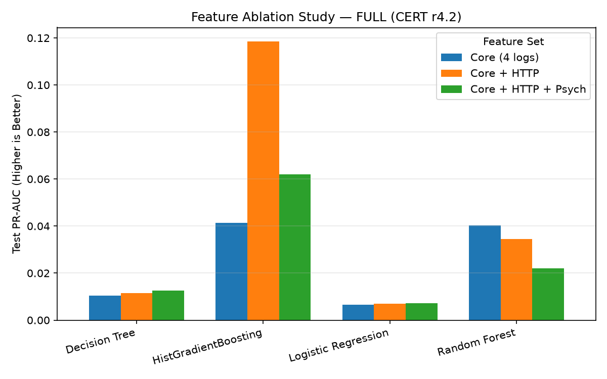
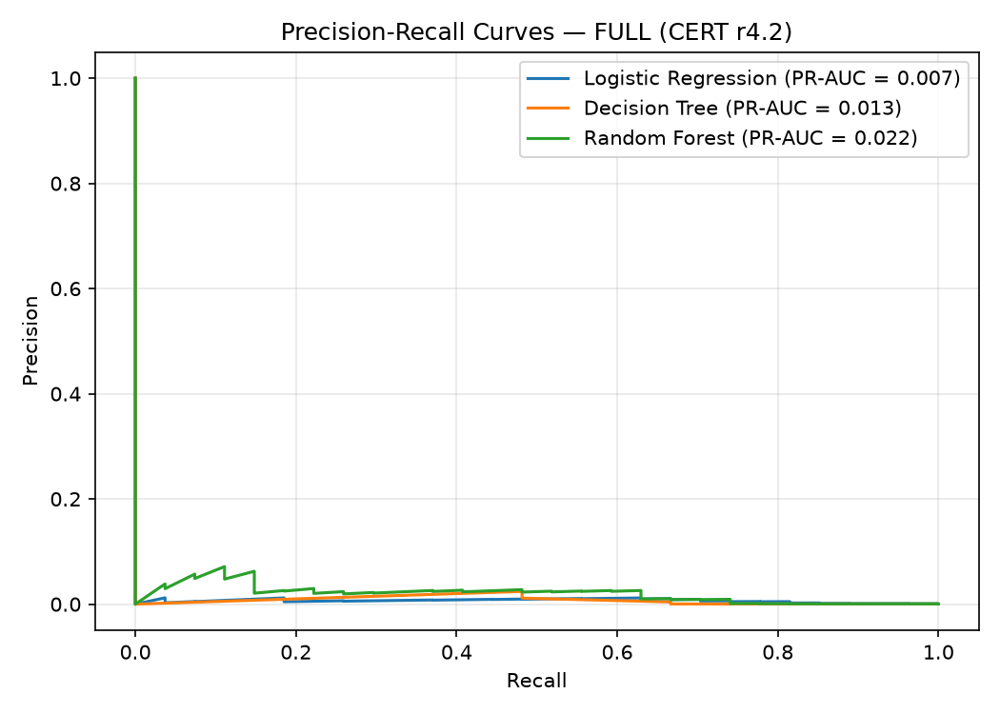
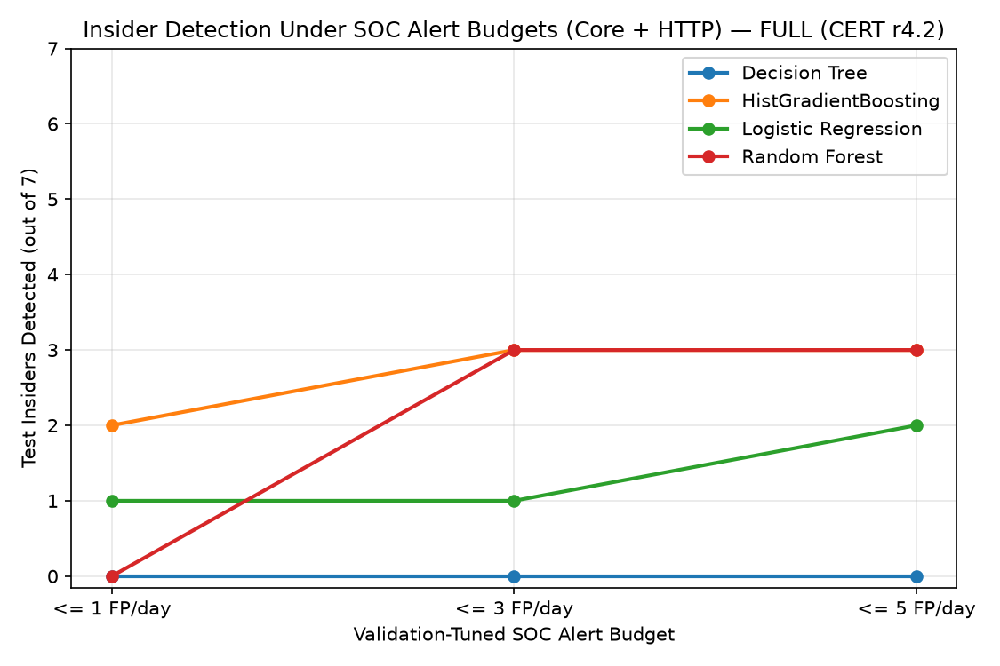
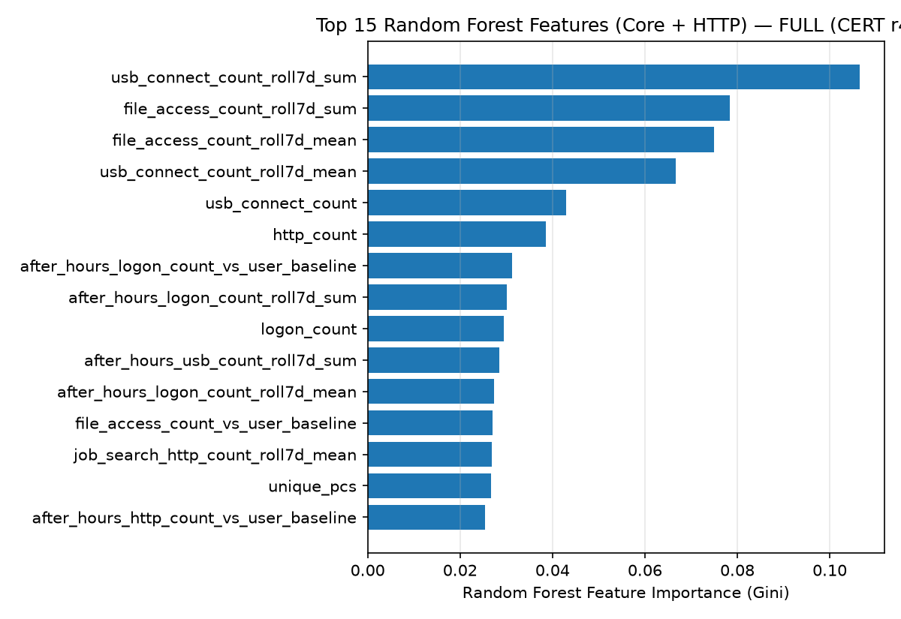

# Early-Warning Insider Threat Detection Using Behavioral Logs on CMU CERT r4.2

**Author:** Radhika Utpal Yagnik (UB Person #50740289)  
**Course:** EAS 510: The Basics of AI (Fall 2026)  
**Repository:** https://github.com/radyagnik/eas510-project2-50740289  

---

## Abstract

Most insider threat detection studies evaluate classifiers on events recorded *during* an attack, after data exfiltration has already begun. This project investigates a stricter operational question: **can supervised machine learning models trained on daily behavioral logs warn a Security Operations Center (SOC) 1 to 7 days *before* an insider initiates data theft, while keeping daily false positives within realistic analyst budgets?** Using the Carnegie Mellon University (CMU) CERT Insider Threat Test Dataset r4.2, we aggregate five raw enterprise log streams (`logon`, `device`, `file`, `email`, and `http`) into 328,638 user-days across 1,000 employees, excluding all observations on or after each insider's attack start date. Under a strict chronological 60% / 20% / 20% split (test prevalence = 0.044%, 27 positive warning days across 7 unseen test insiders), we compare a static after-hours USB rule against Logistic Regression, Decision Tree, Random Forest, and HistGradientBoosting across a controlled feature ablation and validation-tuned SOC alert budgets ($\le 1$, $\le 3$, and $\le 5$ false positives per day). Adding chunked web-browsing signals (`http.csv`) nearly tripled HistGradientBoosting test PR-AUC from 0.0414 to **0.1185** (~269× above the random baseline) and achieved 0.3750 precision at 0.05 FP/day. Conversely, adding static psychometric OCEAN traits inflated validation PR-AUC (0.1287 to 0.1546) while cutting test PR-AUC nearly in half (0.1185 to 0.0619) due to user-ID memorization. Under a $\le 3.0$ FP/day budget, Random Forest and HistGradientBoosting each warned 3 of 7 test insiders early (with up to 6–7 days of lead time on Scenario 2), though acute sabotage (Scenario 3) remained undetected. The small number of test insiders ($n = 7$) limits statistical precision, but the evidence demonstrates that strictly behavioral ensembles outperform static rules while underscoring the necessity of leakage-free temporal evaluation and alert-budget thresholding.

---

## 1. Introduction

Insider threats represent one of the most damaging and difficult-to-detect risks in enterprise cybersecurity. Unlike external adversaries who must breach perimeter defenses, malicious insiders already hold legitimate credentials, authorized workstation access, and familiarity with internal data repositories. Traditional signature-based controls and static Security Information and Event Management (SIEM) rules struggle to separate routine administrative work from malicious preparation without overwhelming analysts with false alarms.

A recurring limitation in academic insider threat literature is that detection is frequently framed as *concurrent* or *post-hoc* classification—flagging malicious activity on the day data theft occurs or across an entire incident window. From a defensive standpoint, alerting a SOC analyst after gigabytes of intellectual property have already been uploaded to an external host or copied to a removable drive limits response options to containment and forensics rather than prevention.

This project investigates **pre-incident early warning**: predicting whether an employee will initiate an insider attack within the next 1 to 7 days based exclusively on behavioral logs observed *before* the attack begins. Specifically, we address three linked questions:

1. **Do supervised behavioral models outperform a static after-hours USB heuristic in early-warning ranking (PR-AUC) and lead time before theft begins?**
2. **How do multi-source feature additions—specifically web browsing (`http.csv`) and static employee personality scores (`psychometric.csv`)—affect temporal generalization to unseen insiders?**
3. **When operating thresholds are constrained to realistic SOC analyst alert budgets ($\le 1$, $\le 3$, and $\le 5$ false positives per day), how many unseen insiders can be warned early, and which attack scenarios remain blind spots?**

To ensure the investigation is feasible within local CPU and memory limits while remaining fully reproducible, we engineer a chunked daily aggregation pipeline in Python 3.11, bundle a clearly labeled 100% synthetic sample for end-to-end verification (`python main.py`), and evaluate all final claims on the full local CMU CERT r4.2 dataset (`python main.py --full`).

---

## 2. Background and Related Work

Insider threat detection has been studied extensively using the CMU CERT Insider Threat Test Dataset family (Glasser & Lindauer, 2013; Lindauer, 2020), which simulates realistic corporate networks with synthetic background employees and injected malicious scenarios. Prior work spans unsupervised anomaly detection—such as deep autoencoders and recurrent neural networks trained to score deviations from normal user streams (Tuor et al., 2017)—as well as supervised sequence and tabular models including LSTMs, CNNs, and gradient-boosted trees (Yuan et al., 2018).

While deep sequence models can capture fine-grained event orderings, tabular tree ensembles remain highly competitive on aggregated daily user-behavior profiles because they naturally model non-linear interactions (e.g., elevated USB usage combined with after-hours logons) and provide interpretable feature importances. Regardless of model family, two methodological pitfalls frequently inflate reported performance in prior studies:

1. **Random or user-overlapping splits:** Randomly shuffling user-days across train and test sets allows models to observe an insider's behavior from the same week in both training and test sets, turning anomaly detection into user memorization.
2. **ROC-AUC under extreme imbalance:** When positive events represent less than 0.1% of all observations, Receiver Operating Characteristic (ROC-AUC) curves appear artificially optimistic because large numbers of false positives barely move the false positive rate. Saito and Rehmsmeier (2015) demonstrate that Precision-Recall curves and Average Precision (PR-AUC) provide a far more informative assessment under severe class imbalance.

Our contribution is not a novel learning algorithm, but a disciplined, leakage-free empirical investigation tailored to operational SOC constraints. We enforce three safeguards rarely combined in introductory benchmarks: (a) dropping all post-attack-start rows so no concurrent exfiltration activity leaks into early-warning labels, (b) splitting strictly chronologically across dates so test insiders are evaluated in the future, and (c) translating raw classifier scores into **false positives per day** and **days of lead time before attack start**, alongside a controlled ablation that exposes how static psychometric features degrade temporal generalization.

---

## 3. Data

### 3.1 Source, Licensing, and Permissions

The primary experimental dataset is the **CMU CERT Insider Threat Test Dataset, Release 4.2 (r4.2)**, published by the Software Engineering Institute at Carnegie Mellon University via KiltHub (Lindauer, 2020; retrieved November 2026). The dataset simulates 1,000 employees over 17 months (January 2010 through May 2011) and contains 70 malicious insider incidents across three documented threat scenarios:

* **Scenario 1:** A user who did not previously use removable drives or work after hours begins logging in after hours, using a removable drive, and uploading data to WikiLeaks before leaving the organization.
* **Scenario 2:** A user begins surfing job websites and soliciting employment from a competitor; prior to leaving, they use a thumb drive at markedly higher rates than their historical baseline to steal data.
* **Scenario 3:** A disgruntled system administrator downloads a keylogger, transfers it via thumb drive to a supervisor's machine, logs in as the supervisor to send an alarming mass email, and immediately leaves the organization.

Because the CERT r4.2 license restricts redistribution of the raw log archive, no raw CERT files are committed to this repository. Exact acquisition instructions from CMU KiltHub and local extraction commands are documented in `README.md`. To satisfy end-to-end reproducibility without violating licensing terms, the repository bundles a **100% synthetic sample** in `data/sample/` generated by `src/generate_sample.py` (`RANDOM_SEED = 42`). The synthetic sample mimics the exact CSV schemas of CERT r4.2 across 40 synthetic users over 100 days (2,798 user-days; 63 positive warning days; 9 synthetic insiders) solely to verify that `python main.py` executes cleanly end-to-end. All scientific conclusions in this report rest exclusively on the full CERT r4.2 dataset.

### 3.2 Raw Log Ingestion, Cleaning, and Observation Unit

One observation in our modeling table represents a single **(user, calendar day)** pair. Table 1 summarizes the raw CERT r4.2 files ingested via chunked streaming (`CHUNK_SIZE = 200,000` rows per chunk in `src/data_prep.py`) to keep peak memory bounded on a standard laptop.

| Source File | Raw Size | Extracted Fields | Cleaning & Aggregation Decisions |
| :--- | :---: | :--- | :--- |
| `logon.csv` | 58.5 MB | `date`, `user`, `pc`, `activity` | Filtered to `Logon` events; counted total logons, after-hours/weekend logons, and unique PCs per user-day. |
| `device.csv` | 29.0 MB | `date`, `user`, `activity` | Filtered to `Connect` events; counted total and after-hours USB connections per user-day. |
| `file.csv` | 193.1 MB | `date`, `user` | Counted total and after-hours file access events per user-day; dropped raw file text content. |
| `email.csv` | 1.36 GB | `date`, `user`, `to`, `cc`, `bcc`, `size`, `attachments` | Flagged external recipients (any address not ending in `@dtaa.com`); summed counts, attachments, and byte sizes. |
| `http.csv` | 14.54 GB | `date`, `user`, `url` | Streamed >28M rows skipping `content`; matched case-insensitive regexes for job-search and upload/cloud domains. |
| `psychometric.csv` | 44.7 KB | `user_id`, `O`, `C`, `E`, `A`, `N` | Deduplicated by user and left-joined as static Big Five personality scores (tested in Experiment 1 ablation). |
| `insiders.csv` | Ground truth | `dataset`, `scenario`, `user`, `start` | Filtered strictly to `dataset == "4.2"`; deduplicated to earliest `attack_start_day` per malicious user. |

All timestamps were parsed with `%m/%d/%Y %H:%M:%S` (`errors="coerce"`), and any rows with unparseable dates were dropped. After-hours activity was defined as any event occurring before 08:00, at or after 18:00, or on Saturday/Sunday (`config.py`). The five behavioral tables were outer-joined on `(user, day)` so that an active day in any log stream is retained, and missing counts for inactive modalities on that day were filled with `0.0`. Because streaming `http.csv` (14.54 GB) takes roughly 5–8 minutes per pass, full-mode runs cache the collapsed daily base table (`daily_base_cache.csv`, ~25 MB) locally outside the Git repository, while all rolling features, label filters, splits, and models are recomputed fresh on every run.

### 3.3 Target Definition, Sample Counts, and Dataset Limitations

For every malicious insider with attack start date $T_{\text{start}}$, we define `days_before_attack` $= T_{\text{start}} - t$. To enforce a strict early-warning formulation:

* **Excluded post-attack rows:** All user-days with $t \ge T_{\text{start}}$ (`days_before_attack <= 0`) for malicious insiders are removed from the dataset before splitting. This prevents the models from learning concurrent data-theft spikes instead of pre-theft warning signs.
* **Positive class (`label = 1`):** User-days where $1 \le T_{\text{start}} - t \le 7$ (the 7-day pre-theft warning window).
* **Negative class (`label = 0`):** All user-days for benign employees and all user-days for malicious insiders more than 7 days prior to $T_{\text{start}}$.

After outer-joining and dropping post-attack insider rows, the full CERT r4.2 dataset contains **328,638 user-days** and **345 positive warning days** (0.105% overall prevalence). Table 2 reports the exact chronological split sizes.

| Split | Date Range | Total User-Days | Positive Warning Days | Prevalence | Test Insiders |
| :--- | :---: | :---: | :---: | :---: | :---: |
| **Train (60%)** | 2010-01-02 to 2010-10-28 | 207,147 | 230 | 0.111% | — |
| **Validation (20%)** | 2010-10-29 to 2011-02-05 | 60,342 | 88 | 0.146% | — |
| **Test (20%)** | 2011-02-06 to 2011-05-17 | 61,149 | 27 | 0.044% | 7 (4 Scen. 1, 2 Scen. 2, 1 Scen. 3) |
| **Total (Full CERT r4.2)** | 2010-01-02 to 2011-05-17 | **328,638** | **345** | **0.105%** | — |
| *Synthetic Sample (Verification Only)* | 2010-01-04 to 2010-04-13 | *2,798* | *63* | *2.252%* | *3* |

**Key data limitations and biases:** First, CERT r4.2 is a simulated enterprise environment; real corporate logs exhibit noisier background bursts, software updates, and shift workers. Second, because insider incidents are rare and unevenly distributed over time, the chronological test window contains only **27 positive user-days across 7 distinct insiders** (only 1 insider in Scenario 3). Third, our URL regexes (`JOB_SEARCH_URL_PATTERN` and `UPLOAD_CLOUD_URL_PATTERN` in `config.py`) capture known domain keywords but do not inspect full page content, trading semantic depth for computational tractability.

---

## 4. Methodology

### 4.1 Feature Engineering and Leakage Safeguards

From the aggregated daily counts, we constructed three nested feature tiers to test in a controlled ablation (`src/data_prep.py`, `main.py`):

1. **Core (4 logs — 26 features):** 11 daily counts from `logon`, `device`, `file`, and `email`, plus 7-day rolling sums, 7-day rolling means, and per-user historical baseline deviations across 5 high-risk signals (`after_hours_logon_count`, `usb_connect_count`, `after_hours_usb_count`, `file_access_count`, `external_email_count`).
2. **Core + HTTP (39 features):** Adds 4 daily web counts (`http_count`, `after_hours_http_count`, `job_search_http_count`, `upload_cloud_http_count`) plus their 7-day rolling sums, 7-day rolling means, and per-user baseline deviations.
3. **Core + HTTP + Psych (44 features):** Adds the 5 static Big Five psychometric traits (`O`, `C`, `E`, `A`, `N`) from `psychometric.csv`.

**Temporal leakage safeguards:** Every rolling window (`rolling(7, min_periods=1)`) uses only days $\le t$. Every per-user baseline deviation computes `col - shift(1).expanding(min_periods=1).mean()`, ensuring day $t$'s baseline uses strictly past days ($< t$) and never leaks current or future activity. Inside every scikit-learn `Pipeline`, `SimpleImputer(strategy="median")` and `StandardScaler()` (for Logistic Regression) are fitted exclusively on `X_train` and applied read-only to validation and test sets.

### 4.2 Baseline and Model Comparison

We compare one domain-inspired heuristic baseline against four supervised classifiers spanning linear, single-tree, bagged-ensemble, and gradient-boosted families (`src/models.py`, configured via `config.py` with `RANDOM_SEED = 42`):

* **Rule Baseline (`Rule: After-Hours USB`):** Flags any user-day with `after_hours_usb_count > 0`. This represents a standard static SIEM alert rule with no machine learning.
* **Logistic Regression:** Regularized linear model with median imputation, standard scaling, `max_iter=1000`, and `class_weight="balanced"`.
* **Decision Tree:** Shallow interpretable tree (`max_depth=5`, `min_samples_leaf=10`, `class_weight="balanced"`) to test non-linear thresholds without ensembling.
* **Random Forest:** Bagged ensemble (`n_estimators=200`, `max_depth=8`, `min_samples_leaf=5`, `class_weight="balanced"`).
* **HistGradientBoosting:** Histogram-based gradient-boosted decision trees (`max_iter=200`, `max_depth=6`, `learning_rate=0.05`, `min_samples_leaf=20`) trained with `compute_sample_weight("balanced", y_train)` to handle the 0.11% training prevalence.

### 4.3 Evaluation Metrics and SOC Alert-Budget Thresholding

Because test prevalence is 0.044%, accuracy and ROC-AUC are uninformative. We evaluate all models using:

* **PR-AUC (Average Precision; higher is better):** Threshold-independent summary of ranking quality under severe imbalance (random baseline = 0.00044 on test).
* **Precision, Recall, and F1 (higher is better):** Day-level classification quality at a chosen operating threshold.
* **False Positives per Day (FP/day; lower is better):** Total test false alarms divided by unique test calendar days, measuring operational SOC analyst workload.
* **Insiders Detected (out of 7) & Warned $\ge 3$ Days (higher is better):** Entity-level early-warning coverage—how many unique test insiders triggered at least one alert during their 7-day pre-theft window.
* **Median & Mean Lead Time (days; higher is better):** Days between an insider's *first* pre-theft alert and `attack_start_day` (computed across detected insiders).

All probability thresholds are selected **exclusively on the validation set** over a dense hybrid grid combining linear steps (`0.01` to `0.99`) and high-probability quantiles (90th to 99.99th percentile). We evaluate two thresholding policies: (1) **Validation-Tuned F1** (standard ML baseline), and (2) **Validation-Tuned SOC Alert Budgets**, selecting the lowest validation threshold whose validation FP/day stays at or below **1.0, 3.0, and 5.0 FP/day**.

---

## 5. Results

All tables and figures below are generated directly by `python main.py --full --data-dir "C:\Users\r12ya\cert_r42\r4.2"` and archived in `results/full/` (`metrics.json`, `ablation_table.csv`, `comparison_table.csv`, `soc_budget_table.csv`, `scenario_breakdown.csv`, and `feature_importance.csv`).

### 5.1 Experiment 1: Controlled Feature Ablation (and an Unsuccessful Attempt)

Table 3 compares Validation and Test PR-AUC across all three feature sets and all four supervised models.

| Feature Set | # Features | Model | Val PR-AUC (↑) | Test PR-AUC (↑) |
| :--- | :---: | :--- | :---: | :---: |
| Core (4 logs) | 26 | Logistic Regression | 0.0093 | 0.0066 |
| Core (4 logs) | 26 | Decision Tree | 0.0239 | 0.0105 |
| Core (4 logs) | 26 | Random Forest | 0.0674 | 0.0403 |
| Core (4 logs) | 26 | HistGradientBoosting | 0.0933 | 0.0414 |
| **Core + HTTP** | **39** | Logistic Regression | 0.0105 | 0.0070 |
| **Core + HTTP** | **39** | Decision Tree | 0.0189 | 0.0115 |
| **Core + HTTP** | **39** | Random Forest | 0.0676 | 0.0346 |
| **Core + HTTP** | **39** | **HistGradientBoosting** | **0.1287** | **0.1185** |
| Core + HTTP + Psych | 44 | Logistic Regression | 0.0095 | 0.0071 |
| Core + HTTP + Psych | 44 | Decision Tree | 0.0210 | 0.0126 |
| Core + HTTP + Psych | 44 | Random Forest | 0.0915 | 0.0221 |
| Core + HTTP + Psych | 44 | HistGradientBoosting | 0.1546 | 0.0619 |

Two clear findings emerge from the ablation:

1. **Web signals (`http.csv`) produced the largest performance jump:** Adding 13 HTTP features nearly tripled HistGradientBoosting Test PR-AUC from **0.0414 to 0.1185** (~269× above the 0.00044 random baseline), with tight validation-to-test consistency (0.1287 vs. 0.1185).
2. **Unsuccessful attempt — static psychometric features caused severe overfitting:** Adding the 5 static OCEAN scores (`Core + HTTP + Psych`) *inflated* Validation PR-AUC for both tree ensembles (Random Forest: 0.0676 → 0.0915; HistGradientBoosting: 0.1287 → 0.1546), which initially caused automated validation selection to choose the 44-feature set. However, on unseen future test insiders, Test PR-AUC collapsed by nearly half for HistGradientBoosting (0.1185 → 0.0619) and dropped 36% for Random Forest (0.0346 → 0.0221). Because each employee's OCEAN vector is constant across all 17 months, tree ensembles exploited those 5 numbers as a **user-ID proxy** to memorize training insiders rather than learning generalizable pre-theft behavioral spikes.

Following this diagnostic finding, we retained `Core + HTTP + Psych` in Experiment 1 as negative evidence and restricted primary model selection to behavioral-only feature sets, where validation mean PR-AUC cleanly selected **`Core + HTTP` (39 features)** without inspecting test labels.

### 5.2 Experiment 2: Baseline vs. Supervised Models (Validation-Tuned F1)

Table 4 evaluates the static rule baseline against all four ML models on `Core + HTTP` using validation-tuned F1 thresholds.

| Model | Val Threshold | Precision (↑) | Recall (↑) | F1 (↑) | PR-AUC (↑) | FP / Day (↓) | Insiders Detected (↑) | Warned $\ge$3 Days (↑) | Median Lead Time (↑) |
| :--- | :---: | :---: | :---: | :---: | :---: | :---: | :---: | :---: | :---: |
| Rule: After-Hours USB | 1.00 | 0.0019 | 0.0741 | 0.0037 | — | 10.42 | 2 / 7 | 1 | 3.5 days |
| Logistic Regression | 0.89 | 0.0080 | 0.4074 | 0.0157 | 0.0070 | 13.49 | 5 / 7 | 2 | 2.0 days |
| Decision Tree | 0.85 | 0.0221 | 0.4815 | 0.0423 | 0.0115 | 5.68 | 5 / 7 | 2 | 2.0 days |
| Random Forest | 0.86 | 0.0769 | 0.0370 | 0.0500 | 0.0346 | 0.12 | 1 / 7 | 1 | 7.0 days |
| **HistGradientBoosting** | **0.91** | **0.3750** | **0.1111** | **0.1714** | **0.1185** | **0.05** | **2 / 7** | **0** | **1.5 days** |

Every supervised model outperformed the static after-hours USB rule on F1 (0.0157–0.1714 vs. 0.0037). **HistGradientBoosting** achieved the highest PR-AUC (**0.1185**), highest F1 (**0.1714**), highest precision (**0.3750**), and lowest alert fatigue (**0.05 FP/day**, roughly one false alarm every 20 days). However, optimizing strictly for F1 under 0.044% prevalence pushed tree-ensemble thresholds to very conservative operating points (0.86–0.91), causing Random Forest to warn only 1/7 insiders and HistGradientBoosting to warn 2/7. Meanwhile, Logistic Regression and Decision Tree warned 5/7 insiders, but only by generating 13.49 and 5.68 false positives per day, respectively.

### 5.3 Experiment 3: SOC Alert-Budget Thresholding and Scenario Error Analysis

To compare models fairly under operational SOC constraints, Table 5 reports test performance when each model's threshold is tuned on validation to satisfy $\le 1.0$, $\le 3.0$, and $\le 5.0$ FP/day.

| Validation Budget | Model | Val Threshold | Precision (↑) | Recall (↑) | Actual Test FP/Day (↓) | Insiders Detected (↑) | Warned $\ge$3 Days (↑) | Median Lead Time (↑) |
| :---: | :--- | :---: | :---: | :---: | :---: | :---: | :---: | :---: |
| $\le 1.0$ FP/day | Logistic Regression | 1.0000 | 0.0127 | 0.0370 | 0.77 | 1 / 7 | 1 | 5.0 days |
| $\le 1.0$ FP/day | Decision Tree | 0.9500 | 0.0000 | 0.0000 | 0.20 | 0 / 7 | 0 | 0.0 days |
| $\le 1.0$ FP/day | Random Forest | 0.8800 | 0.0000 | 0.0000 | 0.07 | 0 / 7 | 0 | 0.0 days |
| $\le 1.0$ FP/day | **HistGradientBoosting** | **0.8900** | **0.2308** | **0.1111** | **0.10** | **2 / 7** | **0** | **1.5 days** |
| $\le 3.0$ FP/day | Logistic Regression | 1.0000 | 0.0040 | 0.0370 | 2.45 | 1 / 7 | 1 | 5.0 days |
| $\le 3.0$ FP/day | Decision Tree | 0.9500 | 0.0000 | 0.0000 | 0.20 | 0 / 7 | 0 | 0.0 days |
| $\le 3.0$ FP/day | **Random Forest** | **0.7900** | **0.0938** | **0.2222** | **0.57** | **3 / 7** | **1** | **2.0 days** |
| $\le 3.0$ FP/day | **HistGradientBoosting** | **0.8285** | **0.0354** | **0.1481** | **1.08** | **3 / 7** | **1** | **2.0 days** |
| $\le 5.0$ FP/day | Logistic Regression | 0.9999 | 0.0101 | 0.1852 | 4.87 | 2 / 7 | 1 | 3.5 days |
| $\le 5.0$ FP/day | Decision Tree | 0.9500 | 0.0000 | 0.0000 | 0.20 | 0 / 7 | 0 | 0.0 days |
| $\le 5.0$ FP/day | Random Forest | 0.7200 | 0.0347 | 0.2222 | 1.65 | 3 / 7 | 1 | 2.0 days |
| $\le 5.0$ FP/day | HistGradientBoosting | 0.7700 | 0.0190 | 0.1852 | 2.55 | 3 / 7 | 1 | 2.0 days |

Lowering thresholds via SOC alert budgets dramatically improved ensemble coverage without losing operational viability. At the **$\le 3.0$ FP/day** budget, both **Random Forest** (0.57 actual test FP/day, 9.38% precision) and **HistGradientBoosting** (1.08 actual test FP/day, 3.54% precision) detected **3 of 7 unseen test insiders**—beating the after-hours USB rule's coverage (2/7) while cutting alert fatigue by **90% to 95%** (0.57–1.08 vs. 10.42 FP/day). Notably, Decision Tree failed under strict SOC budgets (0/7 detected) because a depth-5 tree outputs coarse, discrete leaf probabilities that jump directly from >5 FP/day to 0.20 FP/day, preventing fine-grained threshold calibration.

Table 6 disaggregates the $\le 3.0$ FP/day test results by CERT scenario (`results/full/scenario_breakdown.csv`).

| Model (at $\le 3.0$ FP/day) | Scenario 1 (4 Insiders) | Scenario 2 (2 Insiders) | Scenario 3 (1 Insider) |
| :--- | :---: | :---: | :---: |
| Logistic Regression | 1 / 4 (median 5.0d) | 0 / 2 | 0 / 1 |
| Decision Tree | 0 / 4 | 0 / 2 | 0 / 1 |
| **Random Forest** | **2 / 4 (median 1.5d)** | **1 / 2 (median 7.0d)** | 0 / 1 |
| **HistGradientBoosting** | **2 / 4 (median 1.5d)** | **1 / 2 (median 6.0d)** | 0 / 1 |

### 5.4 Experiment 4: Feature Importance Analysis

To verify that the models relied on plausible pre-theft behavioral indicators rather than spurious artifacts, we inspected Gini feature importances from the Random Forest model trained on `Core + HTTP` (`results/full/feature_importance.csv`).

The top 10 features were dominated by **7-day rolling aggregations** and **per-user historical deviations** rather than single-day counts alone: `usb_connect_count_roll7d_sum` (0.1064), `file_access_count_roll7d_sum` (0.0784), `file_access_count_roll7d_mean` (0.0750), `usb_connect_count_roll7d_mean` (0.0667), `usb_connect_count` (0.0430), `http_count` (0.0385), `after_hours_logon_count_vs_user_baseline` (0.0312), `after_hours_logon_count_roll7d_sum` (0.0302), `logon_count` (0.0294), and `after_hours_usb_count_roll7d_sum` (0.0285). This confirms that sustained multi-day shifts in removable-media use, file access volume, web activity, and after-hours logons relative to each user's own past baseline drive early-warning predictions.

---

## 6. Discussion

### 6.1 Answering the Research Questions

The experimental evidence supports a clear, nuanced answer to our central investigation. **Yes, supervised behavioral ensembles meaningfully outperform a static SIEM rule for 7-day early warning**, achieving up to 0.1185 PR-AUC (~269× random chance) and warning 3 of 7 unseen future insiders at roughly 0.6–1.1 false positives per day (compared to 2 of 7 at 10.42 FP/day for the after-hours USB rule). However, **early warning is far from solved**: even the best models missed 4 of 7 test insiders under a $\le 3.0$ FP/day budget, and precision remains modest (3.5%–9.4% at $\le 3.0$ FP/day, rising to 23.1%–37.5% only at ultra-strict thresholds that catch 2/7 insiders).

### 6.2 Error Analysis: Why Specific Insiders Were Missed

Breaking results down by CERT scenario explains *why* errors occurred:

* **Scenario 2 (Job-Search + USB Ramp-Up) yielded the longest lead times:** Both Random Forest (7.0 days) and HistGradientBoosting (6.0 days) caught 1 of 2 Scenario 2 insiders nearly a full week before theft began. This aligns with the scenario's multi-day behavioral buildup—job-search browsing and elevated USB activity appear in rolling 7-day windows well ahead of the attack start date.
* **Scenario 1 (After-Hours USB + Leak Upload) showed shorter lead times (1.5 days):** Both ensembles caught 2 of 4 Scenario 1 insiders, typically 1 to 2 days before `attack_start_day`, when off-hours logons and upload-domain visits first appeared. The missed Scenario 1 insiders exhibited minimal anomalous activity prior to day 0, making them indistinguishable from normal variance strictly before the attack started.
* **Scenario 3 (Acute Sabotage / Keylogger) was a complete blind spot (0/1 across all models):** Scenario 3 involves a disgruntled administrator executing a sudden, single-event sabotage rather than a week-long staging phase. Because our features measure multi-day behavioral volume and our labels exclude day 0, an attack with no pre-incident behavioral ramp-up cannot be anticipated from daily count aggregates alone.

### 6.3 Methodological Trade-Offs and What Results Do Not Establish

Three critical methodological lessons emerged from this work:

1. **Static user attributes can silently poison temporal validation:** Including `psychometric.csv` looked beneficial on Validation PR-AUC (+0.0259 for HistGradientBoosting) because insiders whose pre-theft windows straddled or closely followed the training period shared static personality profiles, yet it halved Test PR-AUC on genuinely new insiders. In enterprise security modeling, static HR or demographic features should be audited carefully or excluded unless validated under strict user-disjoint splits.
2. **F1 thresholding is misaligned with SOC operations:** Under 0.044% prevalence, maximizing F1 favored ultra-conservative thresholds (0.05–0.12 FP/day) that left most insiders undetected. Tuning thresholds to explicit analyst alert budgets ($\le 1$, $\le 3$, $\le 5$ FP/day) exposed the true operational frontier and revealed that shallow Decision Trees lack the probability resolution needed for alert-budget calibration.
3. **What these results do *not* establish:** Because the chronological test set contains only 7 insiders (27 positive days), individual detection counts have wide uncertainty—catching or missing a single insider shifts entity recall by 14.3 percentage points. Moreover, performance on simulated CERT r4.2 logs does not guarantee equivalent precision on live enterprise telemetry without retraining and site-specific calibration.

### 6.4 Future Work

Three concrete next steps would directly address the limitations observed here: (1) adding **peer-group normalization** using CERT's `LDAP/` organizational role snapshots so a system administrator's baseline is compared against fellow administrators rather than clerical staff; (2) applying **probability calibration** (isotonic or Platt scaling on validation) and evaluating **entity-level alert aggregation** (e.g., triggering an investigation only when a user's risk score remains elevated for 2 consecutive days); and (3) extending the evaluation across **multiple rolling temporal origins** (expanding-window cross-validation across time) to evaluate more than 7 test insiders and tighten confidence intervals.

---

## 7. Conclusion

This investigation evaluated whether supervised machine learning models can provide 1-to-7-day early warning of insider data theft on the full CMU CERT r4.2 dataset (328,638 user-days) under strict temporal and post-attack leakage safeguards. Combining four core enterprise log streams with chunked web-browsing signals (`http.csv`) enabled HistGradientBoosting to reach **0.1185 Test PR-AUC** (~269× above random chance), while validation-tuned SOC alert budgets ($\le 3.0$ FP/day) allowed Random Forest and HistGradientBoosting to detect **3 of 7 unseen test insiders** with up to 6–7 days of advance warning and 90%–95% fewer daily false alarms than a static after-hours USB rule. Equally important, a controlled ablation demonstrated that adding static psychometric scores inflated validation scores while halving test generalization through user-ID memorization, and scenario error analysis showed that acute, no-ramp-up sabotage (Scenario 3) remains outside the reach of daily behavioral counts. Together, these findings show that early-warning insider threat modeling is operationally promising when anchored to strictly behavioral features, temporal splits, and explicit analyst alert budgets.

---

## 8. References

* Glasser, J., & Lindauer, B. (2013). Bridging the gap: A pragmatic approach to generating insider threat data. In *2013 IEEE Security and Privacy Workshops (SPW)* (pp. 98–104). IEEE. https://doi.org/10.1109/SPW.2013.37
* Lindauer, B. (2020). *Insider Threat Test Dataset (Release 4.2)*. Software Engineering Institute, Carnegie Mellon University, KiltHub. https://doi.org/10.1184/R1/12841247.v1
* Pedregosa, F., Varoquaux, G., Gramfort, A., Michel, V., Thirion, B., Grisel, O., Blondel, M., Prettenhofer, P., Weiss, R., Dubourg, V., Vanderplas, J., Passos, A., Cournapeau, D., Brucher, M., Perrot, M., & Duchesnay, É. (2011). Scikit-learn: Machine learning in Python. *Journal of Machine Learning Research*, 12, 2825–2830.
* Saito, T., & Rehmsmeier, M. (2015). The precision-recall plot is more informative than the ROC plot when evaluating binary classifiers on imbalanced datasets. *PLOS ONE*, 10(3), e0118432. https://doi.org/10.1371/journal.pone.0118432
* Tuor, A., Kaplan, S., Hutchinson, B., Nichols, N., & Robinson, S. (2017). Deep learning for unsupervised insider threat detection in structured cybersecurity data streams. In *Workshops at the Thirty-First AAAI Conference on Artificial Intelligence (AI for Cyber Security)*.
* Yuan, F., Cao, Y., Shang, Y., Liu, Y., Tan, J., & Fang, B. (2018). Insider threat detection with deep neural network. In *International Conference on Computational Science (ICCS)* (pp. 43–54). Springer. https://doi.org/10.1007/978-3-319-93698-7_4

---

## 9. Contributions and AI Assistance

This is an individual project completed by Radhika Utpal Yagnik.

**AI Tools Used:** Google Gemini was used as an interactive coding, debugging, and writing assistant throughout the project lifecycle.

**Substantive Contributions:** Gemini assisted with structuring the modular repository (`src/data_prep.py`, `src/models.py`, `src/generate_sample.py`, `main.py`, `config.py`), implementing chunked CSV ingestion and local caching for the 14.5 GB `http.csv` file, debugging path and Windows PowerShell environment issues, designing the validation-tuned SOC alert-budget evaluation, and refining the structure and clarity of `report.md` and `README.md`.

**Verification and Responsibility:** All code was executed locally on the author's machine (Python 3.11.3) on both the synthetic sample and the locally extracted CMU CERT r4.2 dataset. No raw or restricted CERT data was uploaded to any external AI service; only aggregate summary tables and terminal metric outputs were shared during debugging. Every metric, date range, sample count, ablation finding, and figure reported in this document was directly generated by `main.py`, cross-checked against the committed CSV/JSON artifacts in `results/full/` and `results/sample/`, and reviewed by the author for methodological validity and absence of data leakage.